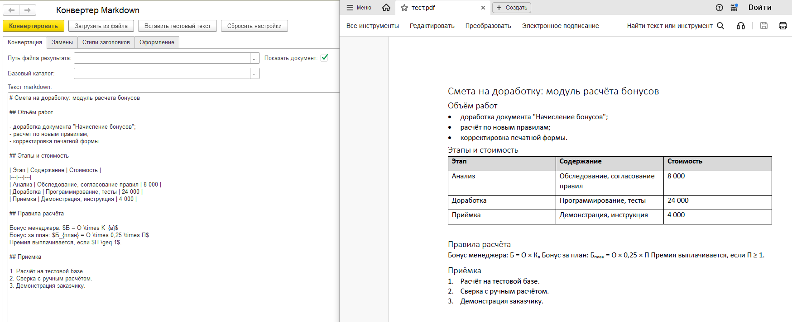
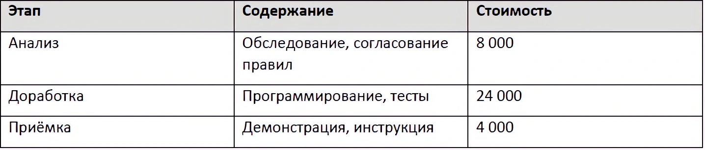
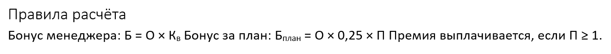

Оригинальная публикация: https://infostart.ru/1c/tools/2818656/

# Конвертер Markdown для 1С

   

Внешняя обработка для 1С:Предприятия на управляемых формах: превращает Markdown-текст в оформленный документ через установленный Microsoft Word. Без внешних компонент, без библиотек, без интернет-сервисов — вся конвертация выполняется на компьютере пользователя.

ИИ-ассистенты (ChatGPT, Claude, Cursor) отдают текст в Markdown, а документооборот в организациях живёт в Word и PDF: согласование, замечания рецензентов, печати, фирменные бланки. Обработка закрывает этот разрыв одним нажатием кнопки.

## Возможности

- Заголовки шести уровней — настоящие стили Word: встроенные «Заголовок 1–6» или стили из вашего шаблона .dotx
- Таблицы с границами, жирной шапкой с заливкой и разметкой внутри ячеек
- Блоки кода и строчный код — моноширинный шрифт на сером фоне (по умолчанию Consolas)
- Настоящие списки Word или текстовые маркеры с собственной нумерацией уровней
- Цитаты, гиперссылки, картинки с автомасштабированием по ширине
- Формулы `$...$` и `$$...$$` — подмножество LaTeX, переводится в Unicode-символы с под- и надстрочными индексами
- Пользовательские замены до разбора, включая регулярные выражения
- Восемь форматов результата: **DOCX, DOC, DOCM, RTF, PDF, XPS, HTML, TXT** — формат задаётся расширением файла

## Скриншоты

<!-- Положите скриншоты в каталог images/ репозитория и поправьте имена файлов -->


*Слева — форма с Markdown-текстом, справа — результат конвертации*


*Таблица с жирной шапкой и заливкой, разметка внутри ячеек*


*Формулы: Unicode-символы и подстрочные индексы*

## Поддерживаемые элементы Markdown

| Элемент Markdown | Результат в Word/PDF | Чем управляется |
| --- | --- | --- |
| Заголовки: `#` ... `######` (шесть уровней) | Настоящие стили Word: встроенные «Заголовок 1–6» или стили из шаблона .dotx | Таблица стилей заголовков |
| `**жирный**`, `*курсив*`, `~~зачёркнутый~~` | Полужирное, курсивное и зачёркнутое начертание | — |
| `` `строчный код` `` | Моноширинный шрифт (по умолчанию Consolas) | Шрифт и размер кода |
| Списки: `-`, `*`, `+`, `1.` | Настоящие списки Word или текстовые маркеры с нумерацией уровней | Режим списков, отступы, пробелы на уровень |
| Таблицы, включая экранирование `\|` | Таблица с границами; жирная шапка с заливкой; разметка внутри ячеек | Цвет шапки |
| ``` ``` блоки кода ``` ``` | Моноширинный шрифт, отступ, фоновая заливка | Шрифт, отступ, цвет фона |
| `> Цитаты` | Курсив, левая линия-граница, фоновая заливка | Отступ, курсив, цвета |
| Картинки: `` | Вставка с ограничением максимальной ширины; относительные пути — от базового каталога | Базовый каталог, максимальная ширина |
| Ссылки: `[текст](адрес)` | Настоящие гиперссылки Word | — |
| Формулы: `$...$` и `$$...$$` | Unicode-символы, под- и надстрочные знаки | — |
| Линии: `---` | Горизонтальная линия | — |

Парсер написан на встроенном языке 1С: разбор внутристрочной разметки выполняется посимвольно, с корректной обработкой экранирования и флэнкинг-правилами — незамкнутая звёздочка останется текстом, а не превратится в курсив.

## Требования

| Компонент | Требование |
| --- | --- |
| Операционная система | Windows — конвертация выполняется через COM-автоматизацию |
| Microsoft Word | 2010+, установленный на рабочем месте пользователя |
| Платформа 1С | 1С:Предприятие 8.3.10+ |
| Режим запуска | Толстый или тонкий клиент |
| Веб-клиент | Не поддерживается: COM-объекты в веб-клиенте недоступны |
| Конфигурация | Любая на управляемых формах; зависимости от БСП нет |
| Интернет | Не требуется: конвертация полностью локальна |

## Установка

Изменений в конфигурации не требуется, подключение возможно двумя способами.

**Разовый запуск** — «Файл — Открыть» в любой конфигурации на управляемых формах. При первом открытии платформа предупредит о внешней обработке: безопасный режим должен быть отключён, иначе создание COM-объекта Word окажется заблокировано.

**Постоянное использование** — «Администрирование — Печатные формы, отчеты и обработки — Дополнительные отчеты и обработки» в конфигурациях со встроенной БСП: обработка сама формирует сведения для регистрации (вид, команду открытия формы, версию), кнопка «Добавить из файла» заполняет их автоматически.

## Быстрый старт

1. Откройте обработку и нажмите «Вставить тестовый текст» — поле заполнится приёмочным примером со всеми поддерживаемыми элементами разметки.
2. Нажмите «Конвертировать» — на экране появится готовый документ.
3. Укажите путь с нужным расширением (например, `.pdf`) — документ сохранится в выбранном формате.

Кстати, этот README — сам Markdown: можно вставить его в конвертер и получить оформленный документ Word.

## Настройка без правки кода

Вся настройка выполняется в форме обработки, на вкладках «Замены», «Стили заголовков» и «Оформление».

| Блок | Что настраивается |
| --- | --- |
| Замены перед разбором | Таблица «шаблон → значение»: обычные строки и регулярные выражения, флаги «регулярное» и «учитывать регистр» |
| Стили заголовков | Маппинг «уровень Markdown → стиль Word»: код встроенного стиля или имя стиля из шаблона |
| Шаблон документа | Путь к .dotx/.dot — фирменный бланк со стилями и колонтитулами организации |
| Шрифты и цвета | Шрифты текста и кода, фоны блока кода, цитат и шапки таблиц (строка вида «242, 242, 242») |
| Списки | Режим: настоящие списки Word или текстовые маркеры; отступы, пробелы на уровень вложенности |
| Прочее | Интервал после абзаца, максимальная ширина картинок, показ документа после конвертации |

Из коробки работает набор типографских замен: «ёлочки» приводятся к прямым кавычкам, длинное тире — к дефису, записи (c), (r) и (tm) превращаются в ©, ® и ™. Замены применяются к тексту до разбора, поэтому ими удобно вводить доменную лексику — например, расшифровывать внутренние сокращения.

Стили заголовков задаются языконезависимыми кодами встроенных стилей (wdStyleHeading1 ... wdStyleHeading6) — обработка одинаково работает в английском и русском Word. Если указать имя стиля из шаблона .dotx, документ сразу получит фирменное оформление.

## Приватность и работа без интернета

Конвейер конвертации — от пользовательских замен до сохранения файла — не выполняет никаких сетевых вызовов. Обработка пригодна для закрытых контуров: недоступность сети никак не влияет на конвертацию.

Для связи с автором в обработке есть две необязательные кнопки: «Регистрация» и «Обратная связь». Страница портала открывается во встроенном поле HTML — это просто просмотр. Отправка данных происходит только после явного нажатия кнопки «Отправить отзыв»: на сервер разработчика уходят текст отзыва, постоянный идентификатор установки (GUID в хранилище общих настроек) и, для авторизованных на портале, e-mail с токеном сессии.

Исходный текст документа не покидает компьютер пользователя.

## Ограничения

- Только Windows с установленным Word; веб-клиент не поддерживается.
- Не поддерживаются: сноски, чек-боксы задач, вложенные таблицы, HTML-вставки и диаграммы Mermaid.
- Пересекающиеся комбинации маркеров (например, `**жирный*закрытие`) могут дать неверную вложенность — осознанное ограничение простого парсера без стека разделителей.
- Замены «до разбора» действуют на весь текст, включая блоки кода. Для замен, которые не должны трогать код, используйте контекст в регулярном выражении (например, `(?m)^(?!```)(.*)$`).
- Настройки не сохраняются между сеансами: при каждом запуске форма заполняется значениями по умолчанию.
- Формулы — подмножество LaTeX без полноценного рендеринга; сложные конструкции рекомендуется выносить картинками.
- Внутритабличная разметка ограничена самим Word: многострочные ячейки и вложенность не воспроизводятся один в один.

## Обратная связь

Предложения и сообщения об ошибках — в комментариях к публикации на Инфостарте или через кнопку «Обратная связь» прямо из обработки.
